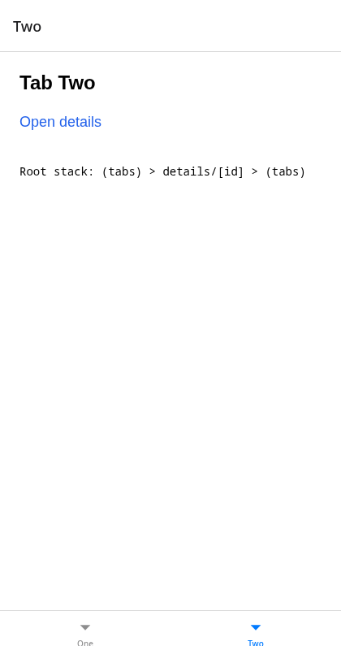
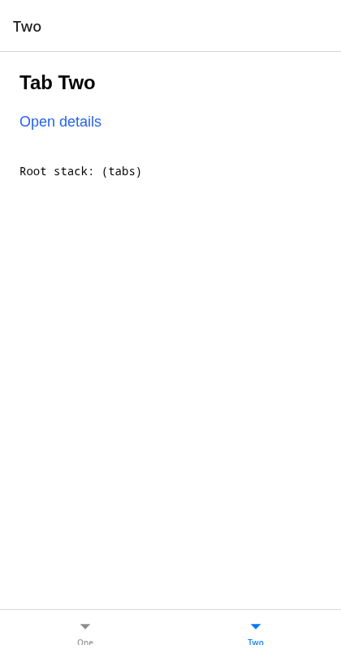

# expo-router: `navigate` pushes a second instance of the tabs

Minimal reproducer for an Expo Router bug: `router.navigate` / `<Link>` to a navigator that is already lower in the stack (here the `(tabs)` group, from a screen pushed over it in the root `Stack`) pushes a second instance of it, instead of going back to it.

Versions: Expo SDK 58 (`expo` 58.0.19), `expo-router` 58.0.26, React Native 0.88.0. It happens on iOS, Android and web (the stack router is the same on all of them).

## The app

```
src/app/
  _layout.tsx        root Stack: (tabs), details/[id]
  (tabs)/_layout.tsx JS Tabs: index ("One"), two ("Two")
  (tabs)/index.tsx   link "Open details" -> /details/1
  (tabs)/two.tsx
  details/[id].tsx   links "Go to tab Two" -> /two, "Go to tab One" -> /
```

Every screen shows the routes of the root Stack (`Root stack: ...`, from `useRootNavigationState`).

## Steps

```sh
bun install
bun run web        # or: bun run ios / bun run android (development build or Expo Go)
```

1. On **Tab One**, press **Open details**. Root stack: `(tabs) > details/[id]`.
2. On **Details 1**, press **Go to tab Two** (a plain `<Link href="/two">`, i.e. `navigate`).

**What you see:** Tab Two is shown, but the root stack is `(tabs) > details/[id] > (tabs)`: a second copy of the tabs was pushed over Details. On iOS/Android, the back button/gesture on Tab Two goes back to Details, and the tabs are in the stack twice.

**What you expect:** the app goes back to the existing tabs and selects Tab Two. Root stack: `(tabs)`. This is what an incoming deep link to `/two` already does, and what the docs say `navigate` does ("either push a new page onto the stack or unwind to an existing route on the stack").

| Before (published 58.0.26) | After (with the fix) |
| --- | --- |
|  |  |

## Trying the fix

`fix/expo-router@58.0.26.patch` is the fix, ported to the published build of `expo-router` 58.0.26 (`build/layouts/stack-router.js`).

```sh
bun run fix        # applies the patch to node_modules/expo-router
bunx expo start -c # restart Metro with a clear cache
```

Repeat the steps: after **Go to tab Two**, the root stack is `(tabs)` with Tab Two selected. `bun run unfix` removes the patch (restart with `-c` again).

`router.push('/two')` / `<Link push href="/two">` still push a new instance, and `navigate` to a screen that holds no navigator still pushes it, as before.

On web, the browser's own history is unchanged by the fix: the browser back button from `/two` returns to `/details/1`, as before.
